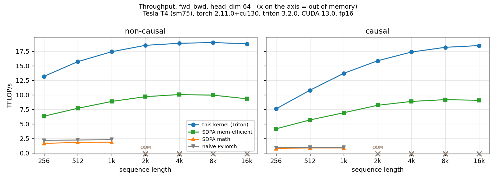
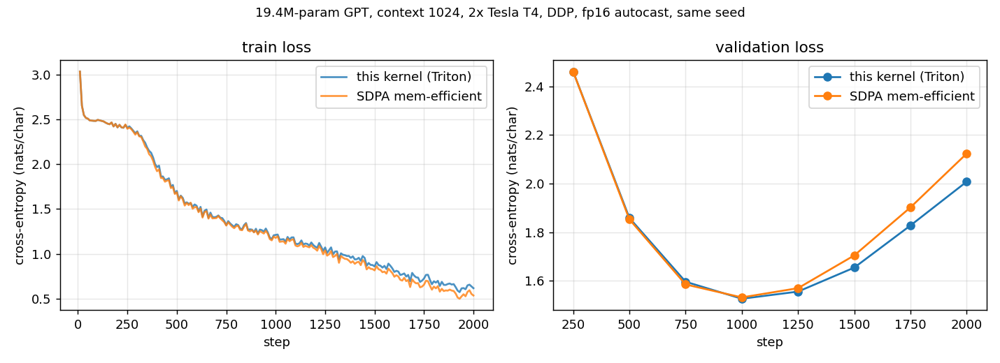

# flash-attention-triton

FlashAttention-2 written from scratch in Triton: forward and backward kernels
behind a `torch.autograd.Function`, with causal masking, grouped-query
attention, sliding windows and variable-length packed batches. The backward
pass is deterministic and uses no atomics.

On a Tesla T4 it runs the forward pass at up to 24.5 TFLOP/s (38% of the fp16
tensor-core peak) and forward+backward at up to 18.8 TFLOP/s, 1.4x to 2.2x
the throughput of PyTorch's memory-efficient SDPA kernel across the
FlashAttention-2 benchmark sweep. As a drop-in replacement for SDPA in a 19M
parameter GPT trained with DDP on two T4s, it trains 5.6% faster with matching
loss curves.

The full write-up is a technical report in paper format:
[docs/report/flash_attention_triton_report.pdf](docs/report/flash_attention_triton_report.pdf)
(LaTeX source in `docs/report/`, built with Tectonic).



## Results

Measured on Kaggle, 2x Tesla T4 (sm75), torch 2.11.0+cu130, Triton 3.2.0,
CUDA 13.0, fp16. The workload is the FlashAttention-2 paper's: 16k tokens per
batch, model width 2048. Throughput at N=16k, in TFLOP/s:

| | d=64 | d=64 causal | d=128 | d=128 causal |
|---|---|---|---|---|
| forward, this kernel | **24.5** | **24.0** | **21.4** | **22.4** |
| forward, SDPA mem-efficient | 12.6 | 13.2 | 11.8 | 11.5 |
| fwd+bwd, this kernel | **18.8** | **18.5** | **14.6** | **15.0** |
| fwd+bwd, SDPA mem-efficient | 9.3 | 9.1 | 9.4 | 9.9 |

Forward+backward peak memory is 708 MB against 900 MB for SDPA
mem-efficient, flat in N; naive attention and SDPA math run out of the T4's
15 GB from N = 2048 (from N = 4096 for the forward pass alone).

The full sweep (N = 256 to 16k, every mode), the method, and an analysis of
where the remaining 62% of peak goes are in
[docs/performance.md](docs/performance.md). The raw data is
[benchmarks/results/t4.csv](benchmarks/results/t4.csv), and all plots are in
[benchmarks/plots/](benchmarks/plots/).

**Training demo.** A 19.4M-parameter character-level GPT (6 layers, width
512, context 1024) trained for 2000 steps on TinyShakespeare, DDP on both
T4s, fp16 autocast with a gradient scaler, identical seed and data order:

| attention | tokens/s | peak memory per GPU | final val loss |
|---|---|---|---|
| this kernel | 161,477 | 1392 MB | 2.008 |
| SDPA mem-efficient | 152,861 | 1346 MB | 2.123 |



The gap between the two curves is of the same size as the gap between two
SDPA runs with the same seed (details in
[docs/performance.md](docs/performance.md#end-to-end-training)). Both models
overfit after step 1000. The demo checks that the gradients train a real
model, not that the model is good.

## A note on Triton versions and Turing GPUs

On sm75 (T4, RTX 20xx), Triton 3.4 through 3.6 compile `tl.dot` to scalar FMA
instead of tensor-core `mma` instructions. Every Triton kernel, including a
plain matmul, then runs 10x to 50x slower while still producing correct
results. Triton 3.3 fails to compile fp16 dots on sm75. Triton 3.2.0
generates tensor-core code and is the version all numbers above use. The
evidence is in [docs/performance.md](docs/performance.md#the-triton-version-matters-on-turing).
On a Turing GPU, install:

```
pip install triton==3.2.0
```

`flash_attention` warns once when it detects an affected combination.
Ampere and newer GPUs are not affected.

## Install

```
pip install -e .            # library
pip install -e .[dev,bench] # plus tests, benchmarks and plotting
```

Requires torch >= 2.4 and triton >= 3.0, and an NVIDIA GPU with compute
capability 7.5 or newer. bf16 needs 8.0 or newer.

## Usage

```python
import torch
from flash_attn_triton import flash_attention, flash_attention_varlen

q = torch.randn(2, 8, 1024, 64, device="cuda", dtype=torch.float16, requires_grad=True)
k = torch.randn(2, 8, 1024, 64, device="cuda", dtype=torch.float16, requires_grad=True)
v = torch.randn(2, 8, 1024, 64, device="cuda", dtype=torch.float16, requires_grad=True)

out = flash_attention(q, k, v, causal=True)       # (batch, heads, seq, head_dim)
out.sum().backward()

# Grouped-query attention: k and v carry fewer heads than q.
k2, v2 = k[:, :2].detach(), v[:, :2].detach()
out = flash_attention(q, k2, v2, causal=True)

# Sliding window: each query sees 256 keys to its left and none to its right.
out = flash_attention(q, k, v, window_size=(256, 0))

# Packed variable-length batch: sequences of length 100, 900 and 24,
# tensors shaped (total_tokens, heads, head_dim).
lens = torch.tensor([0, 100, 1000, 1024], device="cuda", dtype=torch.int32)
qp = torch.randn(1024, 8, 64, device="cuda", dtype=torch.float16)
out = flash_attention_varlen(qp, qp, qp, lens, lens, 900, 900, causal=True)
```

Inputs may have arbitrary strides, and query and key lengths may differ. Query
`i` attends key `j` when `i + off - left <= j <= i + off + right`, with
`off = seq_k - seq_q` (bottom-right alignment). `causal=True` sets `right = 0`,
and `window_size=(left, right)` bounds either side (`-1` means unbounded).
Supported head dims are 16, 32, 64 and 128.

## How it works

[docs/algorithm.md](docs/algorithm.md) derives the method from first
principles: the online-softmax recurrence and its correctness proof, the
base-2 exponent trick, fully masked rows, the backward pass through the
row-wise `delta = rowsum(dO * O)`, IO complexity, and what FlashAttention-2
changes relative to FlashAttention-1.

In short:

- **Forward.** One program per (query block, batch, head). K/V tiles are
  streamed through on-chip memory while a running max and sum rescale the
  accumulator, so the N x N score matrix never exists in global memory. The
  logsumexp per row is saved for the backward pass.
- **Masking.** The key range of each query block is split into fully masked,
  partially masked and unmasked tiles. Fully masked tiles are never visited,
  and only the partial tiles pay for the mask. This one mechanism covers
  causal masks, sliding windows and unequal lengths.
- **Backward.** A small kernel computes `delta`, then a dK/dV kernel (one
  program per key block) and a dQ kernel (one program per query block)
  recompute the attention probabilities from the saved logsumexp. Splitting
  them avoids atomic adds, which makes gradients bitwise reproducible, at the
  cost of two extra matmuls.
- **GQA.** Query heads map to key/value heads by integer division. The dK/dV
  program loops over the query heads of its group and sums their
  contributions in registers.
- **Autotuning.** Block sizes and warp counts are searched per head dim, mask
  type and power-of-two length bucket. Configs that cannot fit in shared
  memory, or need `cp.async` that sm75 lacks, are pruned before compiling.

## Tests

```
pytest                         # GPU
TRITON_INTERPRET=1 pytest      # CPU through the Triton interpreter, small shapes
```

Each output and gradient is compared with an fp32 reference. The tolerance is
not a hand-picked constant: it is twice the error that PyTorch's own fp16
attention makes against the same fp32 reference, plus a small epsilon. The
suite covers sequence lengths 1 to 4096 including unequal and off-by-one tile
boundaries, non-contiguous inputs, every mask type, GQA and MQA, packed
batches, numerical stability under large logits, determinism and the
autotuner. Mutation testing was used to check that the tests catch planted
off-by-one errors in the masks.

| run | where | result |
|---|---|---|
| Kaggle v21 | Tesla T4, Triton 3.2.0 | 629 passed, 180 skipped (bf16 needs sm80; duplicate GQA cases) |
| local | CPU interpreter | 512 passed, 297 skipped |

The CI workflow runs ruff and the interpreter suite on every push.

## Reproducing

```
python benchmarks/run_sharded.py --out-dir benchmarks/results --tag t4  # one process per GPU
python benchmarks/plot_results.py benchmarks/results/t4.csv --out-dir benchmarks/plots
python benchmarks/inspect_kernels.py                                    # registers, spills, mma
bash examples/run_train_demo.sh out/train                              # DDP on all GPUs
```

`kaggle/run_all.py` runs all of the above as a Kaggle script on 2x T4, pinning
Triton 3.2.0 when the GPU predates sm80. The archived outputs of every Kaggle
run are under `kaggle/runs/`.

## Layout

```
src/flash_attn_triton/   _fwd.py, _bwd.py (kernels), _masking.py, _autotune.py, api.py, reference.py
tests/                   correctness suite
benchmarks/              sweep, sharded runner, plots, kernel inspection, results
examples/                GPT training demo and its results
docs/                    algorithm.md, performance.md
kaggle/                  Kaggle entry point and archived runs
```

## Limitations

- All performance numbers come from one GPU model (T4). Ampere and Hopper
  behaviour in [docs/performance.md](docs/performance.md#what-changes-on-newer-gpus)
  is reasoning, not measurement.
- GPU clocks could not be locked on Kaggle. The median relative spread across
  5 repeats is 0.7%, larger for sub-millisecond shapes.
- bf16 is implemented but untested on hardware, since the T4 has no bf16
  tensor cores. The bf16 tests skip on sm75.
- The varlen grid is sized for the longest sequence of the batch. Programs
  beyond a shorter sequence's end exit immediately but are still launched.
- No dropout, no attention bias or ALiBi, and no KV cache for decoding.

## References

- T. Dao, D. Y. Fu, S. Ermon, A. Rudra, C. Ré. *FlashAttention: Fast and
  Memory-Efficient Exact Attention with IO-Awareness.* NeurIPS 2022.
- T. Dao. *FlashAttention-2: Faster Attention with Better Parallelism and
  Work Partitioning.* ICLR 2024.
- M. Milakov, N. Gimelshein. *Online normalizer calculation for softmax.* 2018.
- P. Tillet, H. T. Kung, D. Cox. *Triton: an intermediate language and
  compiler for tiled neural network computations.* MAPL 2019.

## License

MIT
