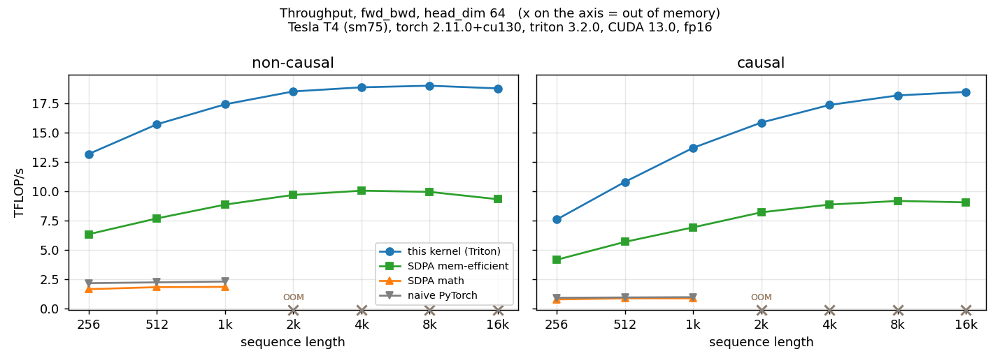
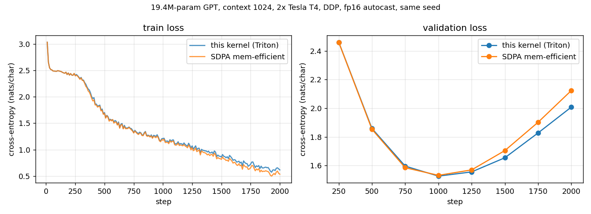

# Performance on a Tesla T4

All numbers on this page were measured on Kaggle, on 2x Tesla T4 (sm75), with
torch 2.11.0+cu130, Triton 3.2.0, CUDA 13.0 and driver 580.178.04, in fp16.
Raw data: [`benchmarks/results/t4.csv`](../benchmarks/results/t4.csv) and its
metadata [`t4.meta.json`](../benchmarks/results/t4.meta.json) (Kaggle run v21).
Plots: [`benchmarks/plots/`](../benchmarks/plots/).

## Method

- **Workload.** The FlashAttention-2 paper's sweep: 16k tokens per batch
  (batch = 16384 / seq_len), model width 2048, so 32 heads at head_dim 64 and
  16 heads at head_dim 128. Sequence lengths 256 to 16384, causal and
  non-causal, forward, backward and forward+backward.
- **FLOPs.** Forward is counted as 4·B·H·N²·d (two matmuls), backward as 2.5x
  the forward and forward+backward as 3.5x. Causal counts are halved. These
  are the standard counts used to compare attention implementations. They do
  not include the extra matmuls a kernel spends on recomputation.
- **Timing.** `triton.testing.do_bench` with the median taken, repeated 5
  times. The table reports the median of those medians. Across all
  configurations of this kernel the median relative standard deviation over
  the 5 repeats is 0.7%. The worst is 28%, for the smallest causal
  backward (N=256, d=128), which runs for less than 1 ms.
- **Isolation.** One process per GPU (`CUDA_VISIBLE_DEVICES`), so no two
  timed kernels ever share a device. The shards split by (head_dim, causal).
- **Clocks.** Locking clocks is not permitted on Kaggle (`nvidia-smi -lgc`
  returns "insufficient permissions", recorded in the metadata). Boost clocks
  therefore vary with temperature, which is part of the variance above.
- **Peak.** The T4's dense fp16 tensor-core peak is 65 TFLOP/s.
- **Baselines.** Each SDPA backend is forced with
  `torch.nn.attention.sdpa_kernel`: `EFFICIENT_ATTENTION` (the
  memory-efficient kernel) and `MATH`. The FLASH_ATTENTION backend needs sm80
  and is not available on this GPU. "naive" is `softmax(QK^T)V` in PyTorch.

## Results

Throughput in TFLOP/s, this kernel / SDPA memory-efficient:

| mode | d | mask | N=256 | N=1k | N=4k | N=16k |
|---|---|---|---|---|---|---|
| fwd | 64 | full | 19.3 / 10.5 | 22.4 / 11.9 | 22.6 / 12.6 | **24.5** / 12.6 |
| fwd | 64 | causal | 12.2 / 8.2 | 16.7 / 11.4 | 22.5 / 12.8 | 24.0 / 13.2 |
| fwd | 128 | full | 17.8 / 10.0 | 20.9 / 11.6 | 21.8 / 12.0 | 21.4 / 11.8 |
| fwd | 128 | causal | 10.6 / 7.6 | 17.9 / 10.8 | 21.2 / 12.1 | 22.4 / 11.5 |
| bwd | 64 | full | 12.2 / 5.6 | 15.7 / 7.9 | 17.8 / 9.2 | 17.7 / 8.6 |
| bwd | 64 | causal | 7.9 / 3.8 | 12.7 / 6.4 | 15.4 / 7.9 | 17.1 / 8.0 |
| bwd | 128 | full | 8.8 / 6.0 | 13.0 / 8.0 | 13.1 / 8.8 | 13.4 / 8.8 |
| bwd | 128 | causal | 7.6 / 3.6 | 11.6 / 6.8 | 13.3 / 8.7 | 13.7 / 9.2 |
| fwd+bwd | 64 | full | 13.2 / 6.3 | 17.4 / 8.9 | 18.9 / 10.0 | 18.8 / 9.3 |
| fwd+bwd | 64 | causal | 7.6 / 4.1 | 13.7 / 6.9 | 17.4 / 8.9 | 18.5 / 9.1 |
| fwd+bwd | 128 | full | 9.5 / 6.5 | 13.7 / 8.6 | 14.4 / 9.7 | 14.6 / 9.4 |
| fwd+bwd | 128 | causal | 7.5 / 4.2 | 12.3 / 7.9 | 14.7 / 9.8 | 15.0 / 9.9 |

The forward pass reaches 21 to 25 TFLOP/s at long sequences, 33% to 38% of
the T4 peak. Forward+backward reaches 14.6 to 18.8 TFLOP/s. Across every
configuration in the sweep this is 1.4x to 2.2x the throughput of the SDPA
memory-efficient kernel. At N=16k, d=64, non-causal, a forward+backward pass
takes 410 ms against 826 ms.

**Memory.** Forward+backward peak memory at d=64 (16k tokens at every N):

| N | naive | SDPA math | SDPA mem-efficient | this kernel |
|---|---|---|---|---|
| 256 | 1794 MB | 2944 MB | 900 MB | 708 MB |
| 1024 | 5634 MB | 9088 MB | 900 MB | 708 MB |
| 4096 | OOM | OOM | 900 MB | 708 MB |
| 16384 | OOM | OOM | 900 MB | 708 MB |

The two tiled kernels use memory that does not depend on N at a fixed token
count, because nothing of size N² is ever materialized. Both naive and math
attention run out of the T4's 15 GB from N = 2048 in this mode (from 4096 for the
forward pass alone).

## Analysis

### Why the backward pass reports lower TFLOP/s

The FLOP count credits the backward pass with five N²d matmuls (2.5x the
forward). This kernel avoids atomics by splitting the backward into a dK/dV
kernel and a dQ kernel, and the dQ kernel recomputes QKᵀ and dO·Vᵀ. It
therefore executes seven matmuls rather than five. Scaling the measured
backward throughput by 7/5 gives the rate at which the tensor cores are busy:
17.7 x 1.4 = 24.8 TFLOP/s at d=64, N=16k. That is the same as the forward
pass at the same shape (24.5). The backward kernels issue matmuls as
efficiently as the forward. They do 40% more of them, which is the price of
being deterministic and atomic-free (see `docs/algorithm.md`).

### Why the T4 tops out near 38% of peak

1. **No asynchronous copies.** `cp.async` arrived with sm80. On sm75 Triton
   cannot software-pipeline the K/V loads (`num_stages > 1` only costs shared
   memory), so the autotuner prunes multi-stage configs. Load latency has to
   be hidden by other warps instead.
2. **Few warps to hide it with.** The winning forward config is
   BLOCK_M=128, BLOCK_N=64 (picked in 25 of the 28 forward searches). Its
   compiled variants use 128 to 255 registers per thread with no spills
   (`benchmarks/results/turing_triton/inspect_triton_3.2.0_v21.txt`). At
   about 200 registers, an 8-warp program uses about 51k of the SM's 64k
   registers, so only one program and 8 of a possible 32 warps fit per SM.
3. **Arithmetic intensity per K/V load.** Each K/V tile loaded from global
   memory feeds 4·BLOCK_M·BLOCK_N·d FLOPs for 4·BLOCK_N·d bytes, i.e.
   BLOCK_M FLOP/byte. That is 128 FLOP/byte at BLOCK_M=128. The T4's ridge
   point is 65 TFLOP/s / 320 GB/s ≈ 200 FLOP/byte. The kernel relies on the
   4 MB L2 to serve K/V to the query blocks of the same head that run
   concurrently. A larger BLOCK_M would raise intensity but needs more
   registers than an sm75 SM can give a resident program.

These are design-level explanations consistent with the measurements: the
register counts are measured, the occupancy and intensity figures are derived
from them. They were not confirmed with a hardware profiler, since Nsight
Compute counters are not accessible on Kaggle.

### Why d=128 is slower in the backward pass

The dK/dV kernel keeps K, V and the dK, dV accumulators in registers for a
whole key block: four BLOCK_N x d tiles. At d=128 this hits the 255-register
cap. The autotuner's picks (`benchmarks/results/t4_shard*.log`) show the
effect: at d=64 most dK/dV searches choose 64x128 tiles (BLOCK_N=128 keys
per program), at d=128 nearly all choose 32x64. Half the keys per program
means half the reuse of every Q and dO tile loaded, so backward d=128 stays
near 13 to 14 TFLOP/s while d=64 reaches 17 to 18.

### Short and causal sequences

At N=256 a whole head is two to four query blocks, so the launch has little
parallelism and the fixed cost per program (loading Q, writing O and the
logsumexp) is a large share of the work. Causal masks are worse at short N
because a larger fraction of the visited tiles lie on the diagonal and run the
masked loop. With block skipping, causal throughput (on half the FLOPs)
approaches the non-causal figure once N ≥ 4k (22.5 against 22.6 TFLOP/s
forward at d=64, N=4k). The skipped blocks cost little and the masked
diagonal is a small share of the work.

## The Triton version matters on Turing

The first benchmark run used Kaggle's bundled Triton 3.6.0 and measured about
1.2 TFLOP/s forward and 0.5 TFLOP/s backward, 10x to 50x slower than above.
The kernels were correct (the full test suite passed and the training demo
matched SDPA). The cause was in the compiler, which was found with
[`benchmarks/inspect_kernels.py`](../benchmarks/inspect_kernels.py):

| Triton | plain matmul (2048³) | our forward, d=64 | PTX for `tl.dot` |
|---|---|---|---|
| 3.2.0 | 9.4 to 21.4 TFLOP/s | 17.2 TFLOP/s | `mma.sync` (tensor cores), no spills |
| 3.3.1 | compile error | n/a | "Unsupported conversion from f16 to f16" |
| 3.4.0 | 0.09 to 1.2 TFLOP/s | 1.22 TFLOP/s | scalar `fma`, up to 970 spills |
| 3.5.1 | 0.09 to 1.3 TFLOP/s | 1.14 TFLOP/s | scalar `fma` |
| 3.6.0 | 0.08 to 1.2 TFLOP/s | 1.25 TFLOP/s | scalar `fma`, up to 1870 spills |

`torch.mm` reaches 18 TFLOP/s on the same GPU, so the hardware is fine. From
3.4 on, Triton lowers `tl.dot` on sm75 to scalar FMA, and even a ten-line
matmul runs 15x slower than cuBLAS. (Releases before 3.2 have no wheels for
the Python 3.13 that Kaggle runs, so they could not be tested.) Raw outputs
are in [`benchmarks/results/turing_triton/`](../benchmarks/results/turing_triton/).

Consequences in this repository:

- The Kaggle runner installs Triton 3.2.0 into a separate directory and puts
  it first on `PYTHONPATH` when the GPU is older than sm80
  (`kaggle/run_all.py`).
- `flash_attention` warns once at runtime when it runs on sm7x with Triton
  3.3 or newer.
- The shared-memory model used for autotune pruning is a lower bound, because
  the same config needs different amounts of shared memory under different
  releases (BLOCK 128x64 at d=128 needs 98 KB under 3.6 but compiles within
  64 KB under 3.2, and is the fastest d=128 forward config). The autotuner
  drops configs the compiler rejects.

## End-to-end training

From [`examples/results/training_summary.json`](../examples/results/training_summary.json):
a 19.4M-parameter GPT, context 1024, batch 8 per GPU, DDP on both T4s, fp16
autocast with a gradient scaler, 2000 steps, same seed and data order for both
runs.

| attention | tokens/s | peak memory per GPU | final val loss |
|---|---|---|---|
| this kernel | 161,477 | 1392 MB | 2.008 |
| SDPA mem-efficient | 152,861 | 1346 MB | 2.123 |

End-to-end training is 5.6% faster. The gain is much smaller than the 2x in
the kernel benchmark because at this model size attention is a minority of
the step: the MLPs, the output projection over the vocabulary, the optimizer
and the DDP all-reduce take the rest.

The loss curves overlap until both models start to overfit (the validation
minimum is at step 1000: 1.526 for this kernel, 1.531 for SDPA). To judge the
gap after that, compare it to the run-to-run noise of the baseline itself.
Two SDPA runs with identical code and seed (Kaggle runs v13 and v21) differ
by 0.018 mean and 0.052 max in train loss, and end at validation losses 2.048
and 2.123. This kernel differs from SDPA by 0.031 mean and 0.089 max. That is
the same order as the baseline's own nondeterminism, which comes mostly from
fp16 rounding and non-deterministic cuBLAS and all-reduce reductions
compounding over 2000 steps.

## What changes on newer GPUs

Not measured here; this is what the design implies.

- **Ampere (sm80, A100 or RTX 30xx).** `cp.async` makes `num_stages` 2 to 3
  useful, and the pruner already allows it from sm80. bf16 becomes available
  and the bf16 tests run. 164 KB of shared memory (A100) admits larger tiles.
  Current Triton releases emit tensor-core code there, so no version pin is
  needed.
- **Hopper (sm90).** Triton can lower `tl.dot` to `wgmma`, but this kernel
  uses explicit pointer arithmetic instead of TMA descriptors and has no warp
  specialization. FlashAttention-3 gets most of its Hopper speedup from those
  two features, so this kernel would leave a large part of H100 throughput
  unused.
